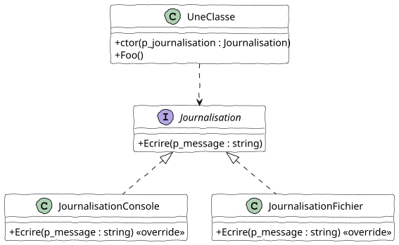

# Injection de dépendances

## Exercice 1 – Journalisation

Reprenez l’interface « Journalisation ».

Écrivez les classes suivantes :

- « JournalisationConsole » : affiche chaque message sur une nouvelle ligne.
- « JournalisationConsoleDateBW » : affiche chaque message en blanc, précédé de la date et de l’heure.
- « JournalisationConsoleDateHeureVert » : affiche chaque message en blanc, précédé de la date et de l’heure écrites en noir sur un fond vert.

Écrivez la classe « De », qui permet de simuler l’utilisation d’un dé à n faces. Afin d’obtenir une valeur, le développeur appelle la méthode « Lancer », qui renvoie la valeur tirée.

Chaque appel à cette méthode doit être journalisé.

L’objet de journalisation doit être injecté par le constructeur.

